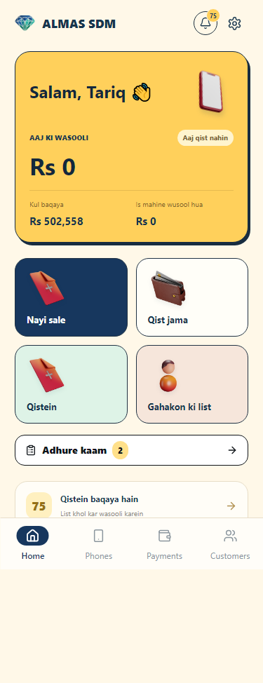
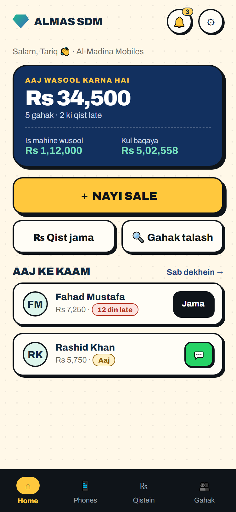
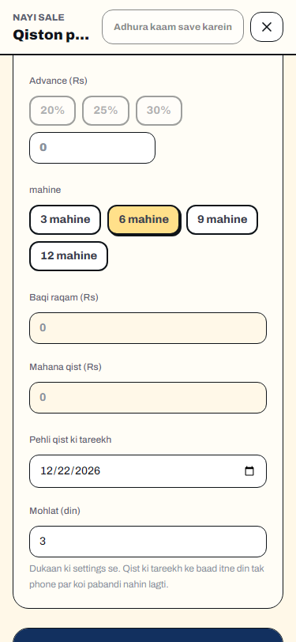
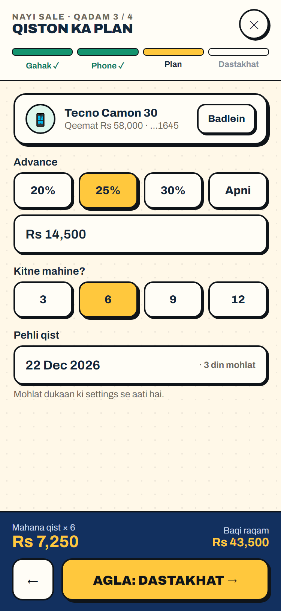
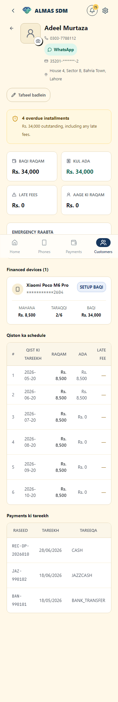
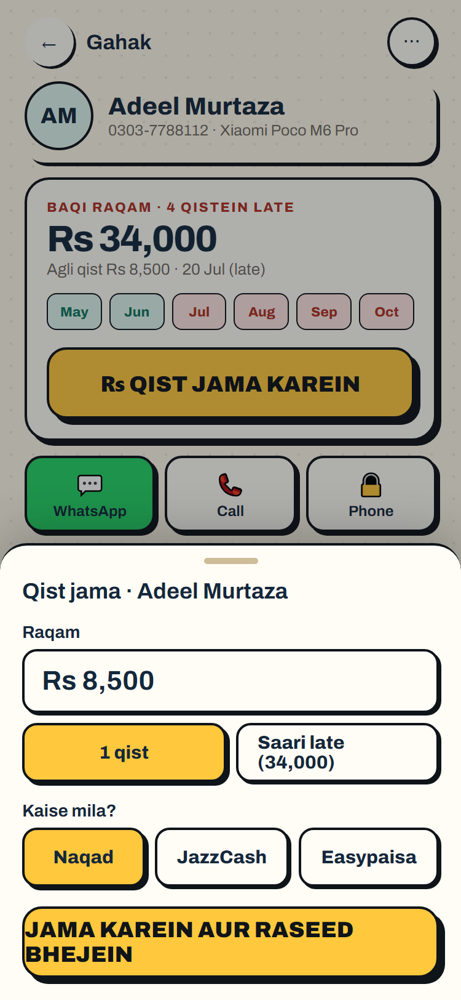
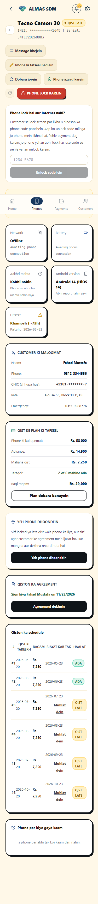
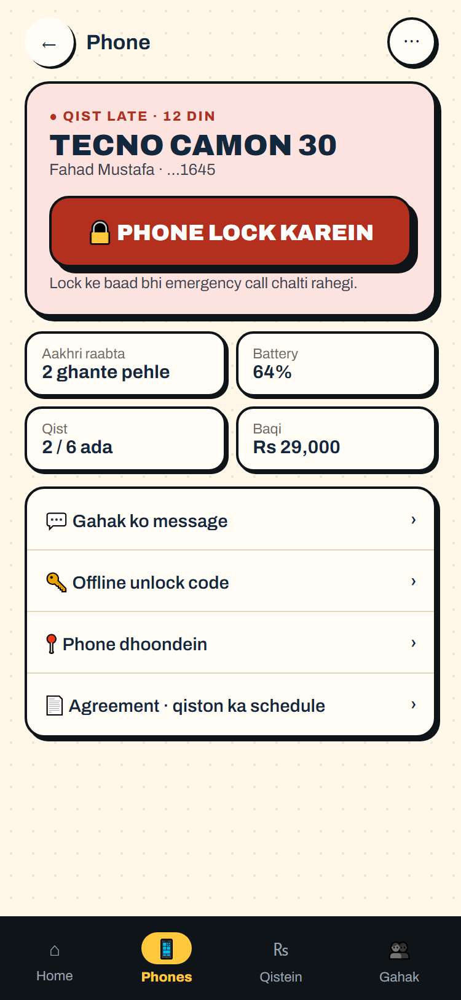
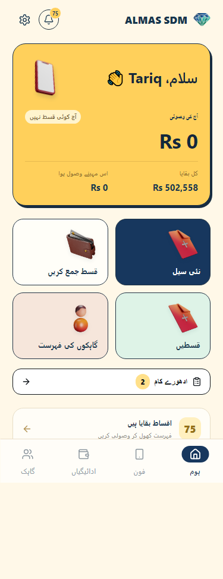
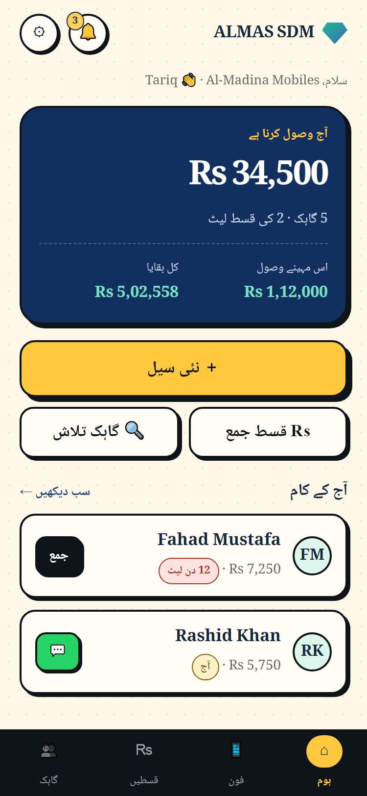

# Shop app redesign — audit aur proposal (approval ke liye)

Tareekh: 23 Nov 2026 · Phone size 375×812 · Shop app ka user agent (`AlmasSDMShop/1.2.4 (Play)`) · Demo shop "Al-Madina Mobiles" (owner Tariq) · Roman Urdu, اردو (RTL), English.

> **Abhi koi code change nahin hua.** Yeh sirf audit aur direction hai. Aap approve karein to har area ka alag PR banega.

---

## 1. Audit — masle, ahmiyat ke hisaab se

### P0 — marketing se pehle zaroor theek hon

1. **Nayi sale ek lambi scroll hai (6–7 screen lambi), koi progress nahin.** Gahak, Phone, Plan, Dastakhat sab ek hi page par. Pata nahin chalta kitna baqi hai; "Sale save karein" button sab se neeche chhupa hai. Header mein title kat jata hai ("Qiston p…") kyun ke "Adhura kaam save karein" button jagah le leta hai.
   `before/roman-ur-sale-00.png … -05.png`
2. **Phone ki qeemat do dafa maangi jati hai** (step 2 "Phone ki qeemat" aur step 3 "Phone ki qeemat" phir se). Advance % chips (20/25/30) qeemat ke baghair disabled dikhte hain, wajah nahin batate.
3. **Phone par tables.** Customers, Payments, Installments, Customer detail, Device schedule — sab desktop tables hain jo 375px par kat jati hain (CNIC, raqam, tareeqa columns screen se bahar). Payments page 6,000px lamba hai, 44 rows, koi search/filter upar nahin. `before/roman-ur-customers.png`, `before/roman-ur-payments.png`
4. **Customer page par "Qist jama karein" button hi nahin.** Sab se zyada hone wala kaam (qist lena) customer ke page se nahin hota; Home ka "Qist jama" tile seedha 44-row ledger par le jata hai. `before/roman-ur-customer.png`
5. **Roman Urdu mein English reh gayi:**
   - Staff page poora English ("Your shop", "Give the people who work with you…", "Add staff", "Your team", "Switch off", "Last signed in") — Urdu mein yeh theek hai, sirf Roman Urdu mein missing. `before/roman-ur-staff.png`
   - Customer detail: "4 overdue installments", "outstanding, including any late fees", "Financed devices", "Late fees".
   - Device: "Awaiting phone connection" (Roman Urdu **aur** Urdu dono mein), "Sign kiya … on 11/23/2026".
   - Nayi sale photo: "Customer photo (optional)", "Camera", "Choose file", "Take the customer's photo…" (Roman Urdu **aur** Urdu dono mein). `before/ur-sale-00.png`
   - Raw enum: "BANK_TRANSFER", "CASH", "JAZZCASH".
6. **Device page par 6 barabar buttons** (Message, Tafseel badlein, Dobara jorein, Azaad karein, refresh, PHONE LOCK) ek dher mein; koi wazeh "abhi kya karna hai" nahin. Unlock-code box har phone par khula hai, chahe phone locked na ho. `before/roman-ur-device.png`

### P1 — achha dikhne aur bharose ke liye

7. **Urdu (RTL) mein labels bohat chhote** — field labels aur "ادھورا کام محفوظ کریں" button ~11px Nastaliq mein parhna mushkil. Placeholder "15 ہندسوں کا IMEI" ulta-pulta (bidi). `before/ur-sale-00.png`
8. **Tareekh teen formats mein:** `2026-05-20`, `28/06/2026`, `12/22/2026` (US). Ek format chahiye: `22 Dec 2026`.
9. **Raqam do formats mein:** "Rs 34,000" aur "Rs. 34,000"; lakh grouping (`5,02,558`) kahin nahin.
10. **Tap targets chhote:** Nayi sale ke saare chips 38px, "Agreement parhein" 26px, select 35px; Payments page par 89 elements 40px se chhote. Android guideline 48px.
11. **Home par do tiles ka ek hi icon** (Nayi sale aur Qistein dono laal lifafa). "Aaj ki wasooli Rs 0 / Aaj qist nahin" — jab late qistein 75 hain tab bhi Home kehta hai aaj kuch nahin; asal kaam ("kis se paise lene hain") neeche "Qistein baqaya hain 75" mein chhupa hai, bottom nav ke peechay.
12. **Do back arrows** (header ‹ aur page ←) customer/device pages par.
13. **Bell par 75** — har late qist notification ban jati hai; badge ka matlab khatam.
14. **Nayi sale ke beech FRP warning ki lambi deewar** (Settings ka kaam sale ke beech). Ek line + link kaafi hai.

### P2 — baad mein

15. Page headers mein label + title dohraya ("CUSTOMERS / Customers").
16. Mono font status cards ke captions par (device page) — baqi app se alag lagta hai.
17. Speed: har screen ~1.3–1.6 s (local), theek hai. Bohat tez clicks par API `429 Too Many Requests` aaya — rate limit counter ke liye tight ho sakta hai (server ka kaam, is redesign mein nahin).

**Naye shop owner ki mushkil (summary):** "Pehli sale kaise karun?" — Nayi sale button hai, lekin form itna lamba hai ke pehli dafa darr lagta hai. "Aaj kis se paise lene hain?" — Home par wazeh nahin. "Qist kaise jama karun?" — customer dhoondo → page par button nahin → Payments table mein jao.

---

## 2. Direction

Brand **bilkul almassdm.pro jaisa** (owner ki shart, har screen par): cream `#FFF8E8` + halke dots, cards `#FFFDF6`, 2–2.5px ink `#0F1419` border aur hard offset shadow (3–6px, blur nahin), Archivo 800/900 uppercase headings, sun-yellow `#FFC83D` main button (site ka `btn-sun`), navy `#12305F` paise wala band, emerald/mint paise ke liye, critical `#B3301F` on `#FDE3DF` late/lock ke liye, WhatsApp-green button (`btn-wa`), kala ink bottom nav. Yeh sab tokens pehle se `client/tailwind.config.js` mein hain; koi naya rang nahin. Mockups mein emoji sirf jagah rakhne ke liye hain; asal mein lucide icons aur `android/shop/src/main/assets/home-icons` wali 3D art rahegi.

| Before | After |
|---|---|
|  |  |
|  |  |
|  |  |
|  |  |
|  |  |

**Home** — Owner ko parent session mein teen home layouts dikhaye gaye: A "Aaj ka kaam", B "Bare buttons", C "Khatra pehle" — abhi faisla baqi hai. Upar ka mockup **A** hai (mera mashwara: counter par sab se zaroori sawal "aaj kis se paise lene hain" seedha jawab deta hai). B ya C chunein to wahi brand style us layout par lagega. Yellow card "Aaj wasool karna hai" (aaj + late), neeche ek bara "Nayi sale" button, do buttons "Qist jama" aur "Gahak talash", phir "Aaj ke kaam": late/aaj wale gahak, har ek par seedha "Jama" ya Call.

**Nayi sale** — 4 qadam, har qadam alag screen: Gahak → Phone → Plan → Dastakhat. Upar progress bar, neeche sticky bar jis mein mahana qist live dikhe aur "Agla" button. Qeemat sirf ek dafa (Phone step mein). Saare chips 48px. Adhura kaam khud save (button ki zaroorat nahin, ✕ dabane par poochhe). Logic/API wahi rahega — sirf layout.

**Gahak / Payment** — Tables ki jagah cards (list mein). Customer page par baqi raqam + 6 mahine ki rangeen patti + bara "Qist jama karein" button. Qist jama neeche se khulne wali sheet mein: raqam pehle se bhari (1 qist / saari late), Naqad/JazzCash/Easypaisa chips, "Jama karein aur raseed bhejein".

**Device** — Upar status card (haalat ke hisaab se rang), aur **sirf ek** main button jo haalat ke mutabiq ho (late → Lock; locked → Unlock; setup baqi → QR). Baqi kaam ek saaf list mein. Unlock code sirf locked phone par.

**Har jagah:** ek tareekh format (`22 Dec 2026`), `Rs 5,02,558` lakh grouping, 48px tap targets, Urdu mein labels 15px+, saari strings teeno zabanon mein (test jo English leak pakde).

---

## 3. PR plan (approval ke baad)

1. **Foundation** — date/money formatters, 48px chips, Urdu type size, missing translations (Staff, Customer, Device, Photo, enums) + ek test jo Roman Urdu/Urdu mein English leak pakde.
2. **Home** — naya layout + "Aaj ke kaam".
3. **Nayi sale** — 4-step wizard, sticky summary, qeemat ek dafa.
4. **Gahak + Qist jama** — card list, customer page, payment sheet; Payments list cards.
5. **Device page** — status card + ek contextual action.

Har PR mein 375px screenshots teeno zabanon mein, `npm test` green. Android shell (`android/shop`) mein change ki zaroorat **nazar nahin aati** — sab `client/src` mein hai, is liye Play par nayi upload nahin chahiye (website deploy hote hi app badal jayegi).

## Aap se faisla chahiye

- Home ke liye A, B ya C? (mashwara: A)
- Baqi screens (Nayi sale, Gahak/Qist jama, Device) ki direction theek hai?
- Bottom nav: "Payments" ki jagah "Qistein" — theek?
- Nayi sale: 4 alag screens (recommended) ya ek hi page lekin upar progress + sticky button?
